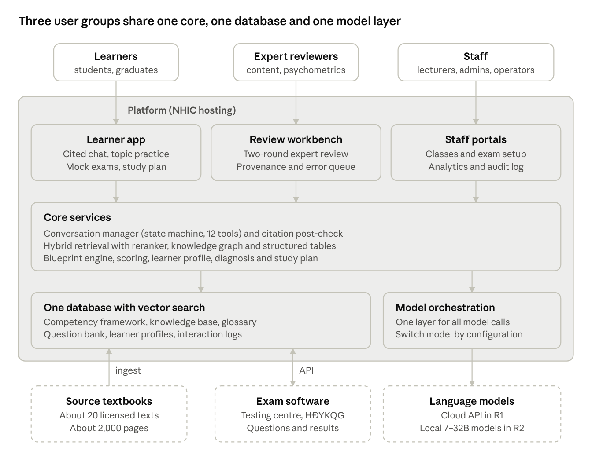
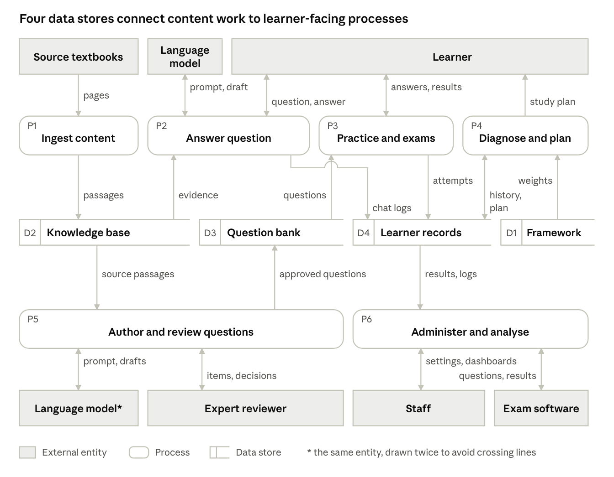
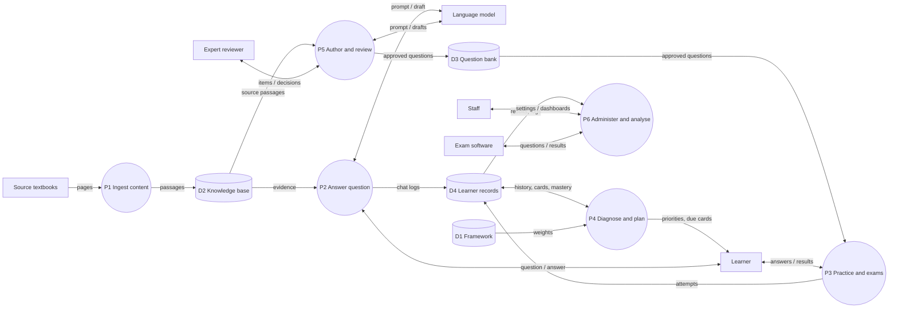
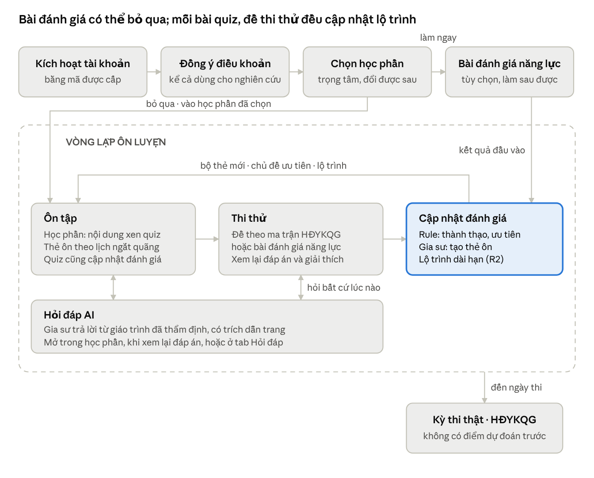
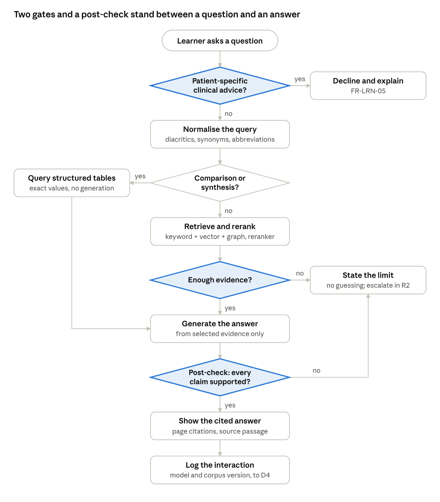
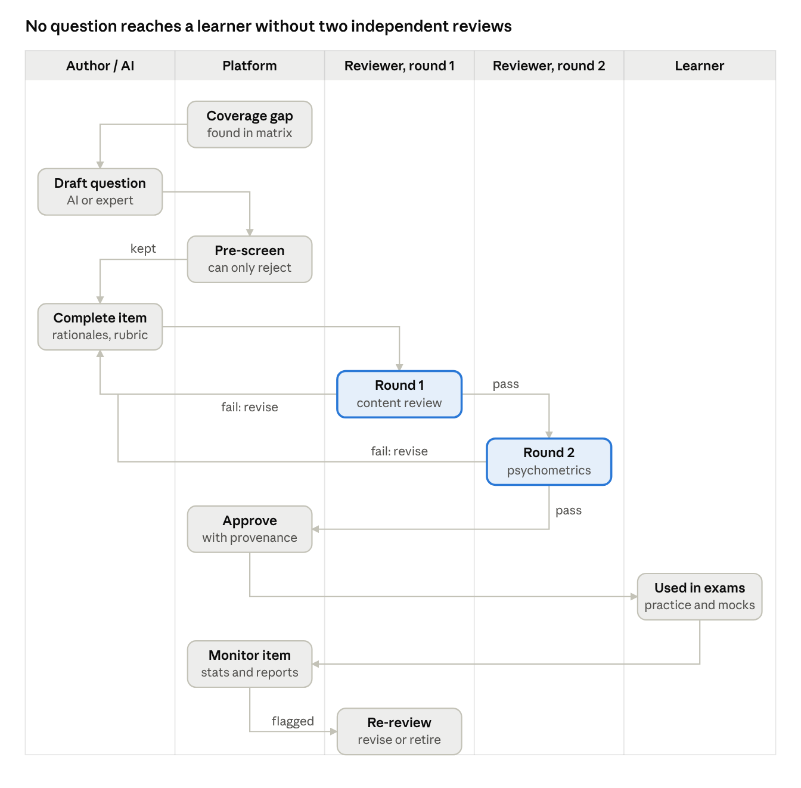

# 03 — Architecture and data flow

## System context

Three user groups (learners, expert reviewers, staff) share one core, one database and one model layer. External systems: ~20 licensed source textbooks (~2,000 pages, ingested), exam software at the testing centre / HĐYKQG (API, R2), language models (cloud API in R1; local 7–32B models in R2). Hosting is NHIC infrastructure (security level to be confirmed, see `09-open-issues.md`).

The diagram's "Conversation manager (state machine, 12 tools)" is the R2 target. R1 implements the chatbot as described in `04-agentic-core.md`.

## R1 components

| Component | Responsibility | Tech (proposed) |
|---|---|---|
| Learner app | iOS + Android; all learner screens in `06-screens.md` | React Native + Expo (alternative: Flutter) |
| Review workbench | Web app for experts: queue, item review, history, error reports; admin CSV import | React / Next.js |
| Business API | Accounts, consent, học phần, units, quiz, exams, cards, reports | Python + FastAPI |
| Agentic core | Model gateway, RAG + tool loop, two-tier post-check, tutor "Giải thích thêm" | Python (same service or separate service behind the API) |
| Learning engine | Rules only: Elo, FSRS, priority, card creation, exam assembly (R1.1) | Python module, unit-tested |
| Ingestion pipeline (batch) | OCR, cleanup, page metadata, chunking, embeddings, BM25 index | PaddleOCR; underthesea for word segmentation |
| Database | Everything in one place | PostgreSQL + pgvector |
| Model API | Generation and post-check in R1 | Commercial cloud API with no-training terms (provider pending) |

Retrieval stack: BM25 over word-segmented Vietnamese (accented and unaccented) + dense vectors (BGE-M3 or AITeamVN/Vietnamese_Embedding) → reranker bge-reranker-v2-m3 (top-50 → top-5, tune the pair count for latency). Chunks of 250–300 tokens with page metadata. The embedding model is chosen once (re-embedding the corpus is expensive).

Licences (checked 10/2026 unless noted): PostgreSQL License; pgvector (PostgreSQL License); BGE-M3 MIT; bge-reranker-v2-m3 Apache 2.0; AITeamVN/Vietnamese_Embedding Apache 2.0; Qwen3 Apache 2.0; underthesea Apache 2.0; pyvi MIT. React Native/Expo, Next.js, FastAPI, ts-fsrs/py-fsrs (MIT), vLLM, PaddleOCR (Apache 2.0) per project pages — re-check before locking. Gemma 3 / MedGemma use Google's own terms: review before choosing.

## Data flow (level 1)

Content enters only through ingestion (P1) and expert review (P5); learners reach it only through the stores those two processes fill. The language model receives prompts and returns drafts; it never reads a data store directly.

### Processes

| ID | Process | R1 notes |
|---|---|---|
| P1 | Ingest content: pages → passages with metadata, vectors and keyword index | Batch; corpus versioned |
| P2 | Answer question: normalise, retrieve, generate, post-check, log | See `04-agentic-core.md` |
| P3 | Practice and exams: serve approved items, score, record attempts | Deterministic; no model in the scoring path |
| P4 | Diagnose and plan: mastery, priority, cards, (R2) study plan | Rules in R1 |
| P5 | Author and review questions (and AI-drafted learning content) | Two expert rounds in the workbench |
| P6 | Administer and analyse: users, settings, dashboards, exports, exam software exchange | R1: import, monitoring, backups |

### Data stores

| Store | Written by | Read by |
|---|---|---|
| D1 Competency framework (from QĐ 2755/QĐ-BYT and the 54 core issues) | Set up once (CV5.1) | P4 |
| D2 Knowledge base | P1 | P2, P5 |
| D3 Question bank | P5 | P3 |
| D4 Learner records (profile, attempts, cards, plans, chat logs) | P2, P3, P4 | P4, P6 |

### Flows

| From | To | Data |
|---|---|---|
| Source textbooks | P1 | pages |
| P1 | D2 | passages |
| D2 | P2 | evidence |
| P2 ↔ Language model | | prompt, draft |
| Learner ↔ P2 | | question, answer |
| P2 | D4 | chat logs |
| D3 | P3 | questions (approved only) |
| Learner ↔ P3 | | answers, results |
| P3 | D4 | attempts |
| D4 ↔ P4 | | history, plan, mastery, cards |
| D1 | P4 | weights, prerequisites |
| P4 | Learner | priorities, due cards, (R2) study plan |
| D2 | P5 | source passages |
| P5 ↔ Language model | | prompt, drafts |
| Expert reviewer ↔ P5 | | items, decisions |
| P5 | D3 | approved questions |
| D4 | P6 | results, logs |
| Staff ↔ P6 | | settings, dashboards |
| Exam software ↔ P6 | | questions, results (R2) |

## Learner journey

Activation (code) → consent → choose học phần (multi-select, changeable later) → diagnostic quiz **or skip** → study loop until exam day: study (học phần units with quizzes, revision cards) ⇄ mock exam → system updates the assessment (rules: mastery, priority; R1.1 agent: new cards) → back to study. AI Q&A is available at every step. A learner who skips the diagnostic starts "unassessed"; priorities come from the chosen học phần then blueprint weight (FR-LRN-37). No screen predicts the real exam score.

## Key processes

### Answering a question (P2)

Gate 1 declines patient-specific clinical advice. Gate 2 ("enough evidence?") states the limit instead of guessing. The post-check drops unsupported claims. Comparison / synthesis questions read exact values from structured tables (R2; R1 uses `lookup_table` where tables exist). R1 detail in `04-agentic-core.md`.

### Question lifecycle (P5 → P3)

Status list (one source of truth): `draft` → `prescreen` (automatic, deterministic in R1.0: duplicates, format, answer key vs source; can only reject or pass; the trained filter FR-CNT-19 is R2) → `in_review_r1` (content) → `in_review_r2` (psychometrics, different reviewer) → `approved` → used in quizzes, mocks, cards → monitored (item statistics, error reports) → flagged → new version back to `in_review_r1`, or `retired`. Reviewer decisions: **Đạt** (pass → next round or `approved`), **Cần sửa** (`needs_revision` → back to the author, new version), **Loại** (`rejected`, terminal for that version). Every transition is logged with reviewer, date, decision and reason (FR-CNT-15). AI-drafted learning content for học phần units follows the same path.

## Data groups

| Data group | What it holds | Personal data | Handling |
|---|---|---|---|
| Competency framework | Four-level tree, immutable IDs, prerequisites, blueprint weights | No | The key every other group points to |
| Knowledge base | ~2,000 pages from 20 texts as ~5,000 passages with metadata and vectors; (R2) knowledge graph and 5 structured tables | No | Licensed; excerpt limits apply |
| Glossary | 1,500–2,000 expert-approved terms and synonyms | No | Expert-approved only; never auto-generated |
| Question bank | Questions, distractor rationales, source links, rubrics, review log, item statistics | Reviewer names | Provenance for every version |
| Learner profile | Account, consent, attempts, options chosen, timing, mastery, cards, chat session state | Yes | Project infrastructure only; never used for training |
| Learning analytics | Interaction logs, usage metrics, research exports | Pseudonymised | Research use under consent and ethics approval |
| System | Users, roles, audit log, configuration, model and corpus versions | Yes | Audit log immutable |

## Proposed data model (R1)

Names are suggestions; keep the semantics. All content tables are versioned; nothing is hard-deleted.

| Entity | Key fields |
|---|---|
| `competency_node` | id (immutable), parent_id, level (1–4), code, name, blueprint_weight, prerequisite_ids[] |
| `core_issue` | id (1–54), name, blueprint_weight |
| `document` | id, code, title, edition, version, validity_status, excerpt_limit |
| `passage` | id, document_id, chapter, lesson, section, page_start, page_end, competency_code, content_type, scope_of_use, validity_status, version, text, text_unaccented, embedding (vector), tsv (keyword index), corpus_version |
| `glossary_term` | id, term, synonyms[], status |
| `module` (học phần) | id, name, order, competency_codes[] |
| `unit` | id, module_id, order, topic, competency_code |
| `unit_item` | id, unit_id, order, kind (content \| quiz \| remediation), content_id \| question_id |
| `content_item` | id, version, body (markdown), source_passage_ids[], status, ai_assisted |
| `question` | id, version, type (mcq \| short \| calc), stem, options[{key, text, is_correct, rationale}], explanation, rubric[{point, weight}], competency_code, core_issue_id, bloom_level (1–3), difficulty_label, difficulty_b, n_responses, source_passage_ids[], status, author_id, ai_assisted |
| `review_decision` | question_id, version, round (1 \| 2), reviewer_id, decision (pass \| revise \| reject), comment, created_at |
| `error_report` | id, target_type (question \| answer \| card \| content), target_id, reason, note, learner_pid, context (json), status |
| `exam_form` | id, title, kind (diagnostic \| mock), question_ids[] (ordered), seconds_per_question (60–75), max_attempts (nullable), status |
| `exam_attempt` | id, learner_id, form_id, started_at, deadline_at (server), submitted_at, auto_submitted, score |
| `item_response` | id, learner_id, question_id, context (unit \| diagnostic \| mock), attempt_id, chosen, correct, flagged, changes, time_ms, created_at |
| `learner` | id, pseudonym_id, activation_code_hash, consent_version, consented_at, research_consent (bool, withdrawable), focus_module_ids[], exam_date, target_retention (0.85 \| 0.90 \| 0.95), new_cards_per_day, diagnostic_prompt_dismissed |
| `mastery` | learner_id, competency_code, theta, n_responses, status (unassessed \| assessed), updated_at |
| `card` | id, learner_id, source_question_id, source_context (unit \| diagnostic \| mock), front, back, citation, fsrs_state, stability, difficulty, due_at, reps, lapses, suspended, buried_until (R1.1), created_by (rule \| agent) |
| `card_review` | card_id, rating (1–4), reviewed_at, elapsed_days, scheduled_days |
| `chat_session` | id, learner_pid, title, created_at, updated_at |
| `chat_message` | id, session_id, role, text, state (answered \| insufficient_evidence \| declined), citations[{passage_id, page}], model_version, prompt_version, corpus_version, latency_ms, tokens_in, tokens_out, cost |
| `audit_log` | id, actor_id, action, target, at, details (append-only) |
