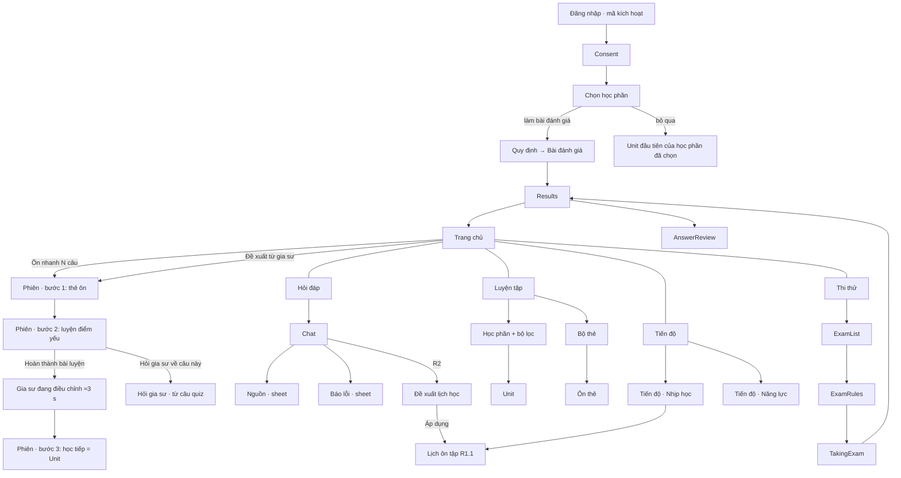

# 06 — Screens

Updated 11/10/2026 after the PO design review. The learner app is designed phone-first (base 360–390 px) and widened for desktop; the reviewer and staff areas are desktop-first and stay usable on a phone.

The PO asked that the product **look smart**: adaptive question selection, revision cards and the tutor must be visible on screen, not hidden in the back end. The rules in "Making the system visible" below come from that review and apply to every screen.

## Navigation

| Width | Learner | Reviewer / staff | Secondary content (source, explanation, report) |
|---|---|---|---|
| Phone < 600 px | Bottom tab bar: **Trang chủ · Hỏi đáp · Luyện tập · Thi thử · Tiến độ**; account from the avatar on Home | Top bar + menu drawer; queues and dashboards as card lists | Bottom sheet over the current screen |
| Tablet 600–1023 px | Left icon rail with labels | Collapsible left rail | Sheet, or right panel in landscape |
| Desktop ≥ 1024 px | Left sidebar, same five items; content ≤ 1,200 px | Fixed left sidebar; full tables and filters | Side panel beside the content |

Rules at every width: the five learner destinations never change order or name; a mock exam in progress hides all navigation; the daily session (Phiên hôm nay) and chat opened from a quiz item hide the tab bar and show a close/back control; anything opened from a citation opens over the current screen and closes back to it.

## Site map

The PNG site maps in `diagrams/` predate the 10–11/10 changes (they show the old Home and a single Progress screen). **The mermaid chart below is authoritative.**

Staff: review queue → review item (Bàn thẩm định); admin users and bulk import; operations; **Quản lý cấp Bộ** read-only dashboards (overview R1.1, learning results R2). Lecturer portal, classes, exam scheduling: R2.

## Making the system visible (rules from the PO review)

1. **Every recommendation states its reason**, in one line, from rule output: why this order ("Vì sao thứ tự này?"), why this question ("Vì sao câu này?"), why this card ("Vì sao ôn câu này?"), why this tutor suggestion.
2. **Show the reaction right after each answer.** After a quiz answer, a dark panel says what changes next: next item easier/harder or same type, card created, tomorrow's priority.
3. **Make invisible processing visible, but only with real data.** The adapting screen, the chat work trace and the "Đã cập nhật ôn tập" block list only things that actually happened for this attempt or query. Never fabricate steps, delays or counts. Every such screen is skippable and respects reduced motion.
4. **Smart but honest.** Page citations, an explicit "removed one claim without a source" notice, "chưa đủ căn cứ" instead of guessing, no predicted scores or pass probability anywhere (FR-LRN-26).
5. **The AI mark.** A four-point gold star marks content proposed by the tutor or a model (Home "Đề xuất từ gia sư", chat suggestions, plan card, adapting screen). It is not used for rule-only content or for expert-approved content.
6. **Reasons and sources are collapsed by default on cards.** Card back shows underlined links "Nguồn", "Vì sao ôn câu này?" and (R1.1) "Đường ghi nhớ"; each expands in place. Reference: `mock/explorations/SmartA_Cards` and `SmartE_Card`. The current-flow mock `SessionCards` still shows them expanded; build the collapsed version.

## Screen inventory — learner (mobile-first)

Phase uses the R1.0 / R1.1 / R2 split from `01-scope-and-plan.md`. Desktop columns apply from R1.1 (learner web); R1.0 is the phone app only. "Mock" = file in `mock/` and PNG in `screenshots/`. "States" = Tweak options in the mock or states built into the screen.

| Screen | Entry | Phone layout (design source) | Phase | Mock | States | Requirements |
|---|---|---|---|---|---|---|
| Đăng nhập | App start | Bộ Y tế red header with gold rule (logo, managing unit, app name); activation-code field; "Đăng nhập"; help link; medical disclaimer + terms/privacy links; acknowledgement line. Logo, unit and acknowledgement are placeholders (open issue 19) | R1.0 | `Login` | error, loading (not mocked) | FR-ADM-01, 02 |
| Consent | After login | Scrolling notice, two consents (service required; research use optional), continue | R1.0 | — | | FR-ADM-03 |
| Chọn học phần | After consent | Multi-select học phần cards (≥ 1); "Làm bài đánh giá năng lực" or "Bỏ qua, vào học ngay"; both disabled until one is picked | R1.0 | `Focus` | none / some selected | FR-LRN-36, 37 |
| Trang chủ | Tab | Greeting + avatar; search; two tiles: **"Ôn nhanh N câu"** (green, starts the session) and next mock exam; card **"✦ Đề xuất từ gia sư"** listing up to 3 things the tutor/rules did since last time (cards created from wrong answers, example added to a unit, practice items added), each with one action link; "Tiếp tục" list (units, chats) | R1.0 (suggestions from rules; agent-written items R1.1) | `Main` | | FR-LRN-30, 31, 34, 36 |
| Phiên · bước 1: thẻ ôn | Home | Header with close, count, 3-step progress bar (Thẻ ôn · Luyện điểm yếu · Học tiếp); card front → reveal → back; rating Quên / Khó / Nhớ / Dễ with next interval under each; finished screen with tomorrow's count and "Bước 2" preview. Reasons/sources collapsed (rule 6) | R1.0 | `SessionCards` (+ `explorations/SmartA_Cards`) | front / back / finished | FR-LRN-34 |
| Phiên · bước 2: luyện điểm yếu | Session | 6 items on the competency with most recent errors; result dots + difficulty indicator; "Vì sao câu này?" chip; MCQ; expert explanation + distractor rationale; **"Hỏi gia sư về câu này"**; source chip; dark "next" panel (harder / same type easier / card created). Last item → "Hoàn thành bài luyện" | R1.0 (fixed set + remediation) · R1.1 item-by-item difficulty | `SessionQuiz` (+ `explorations/SmartD_Quiz` for the difficulty track and ZPD gauge) | unanswered / right / wrong / last | FR-LRN-12, 33, 34, 36 |
| Gia sư đang điều chỉnh | After step 2 | Dark full screen ≈ 3 s: AI star, title, progress bar, 4 lines ticking in (Chấm bài · Cập nhật mức thành thạo · Tạo thẻ ôn từ câu sai · Sắp xếp lại phiên ngày mai) each with its real result; then "Bước 3: Học tiếp" and "Dừng ở đây, về trang chủ"; "Bỏ qua" always visible | R1.0 | `SessionAdapting` | animating / done; reduced motion = static | FR-LRN-36 |
| Phiên · bước 3 / Unit | Session, Luyện tập | One item at a time (content or MCQ); path bar; remediation inserted after a wrong answer says why ("Đã thêm 1 ví dụ… vì bạn chọn 5%"); end screen | R1.0 (fixed order) · R1.1 adaptive | `Unit` | content / quiz / wrong / remediation / end | FR-LRN-32, 33 |
| Tutor sheet | Unit | "Gợi ý" (before answering), "Giải thích thêm" (after); no free text in R1.0 | R1.0 (Should) | `Unit` | | FR-LRN-35 |
| Luyện tập | Tab | Search; filters (domain, core issue, level); dark "Thẻ ôn" shortcut with due count; học phần cards with progress | R1.0 | `Modules` | | FR-LRN-10, 30, 34 |
| Quiz item · AI-assisted | Practice | Permanent AI label, source passage, not counted for mastery | R2 (if the tier is kept, open issue 11) | `QuizAI` | | FR-LRN-15 |
| Quiz item · freeform | Practice | Answer, rubric-point grading, low confidence says so and gives no mastery credit | R1.1 | `Practice` | graded / low confidence | FR-LRN-16 |
| Hỏi đáp | Tab | See "Chat states" below | R1.0 (states 1–7) · R1.1 calc card · R2 plan | `Chat`, `DesktopChat` | 9 states | FR-LRN-01–06, 28 |
| Hỏi gia sư · từ câu quiz | Step 2 / Unit quiz | Back to the session; context card (item, learner's wrong option); explanation with citations; "Làm câu tương tự" / "Quay lại bài luyện"; no tab bar | R1.0 | `ChatQuiz` | | FR-LRN-01–04, 35 |
| Đề xuất lịch học | Hỏi đáp | Learner states free time; trace chip ("Đã xem 12 thẻ đến hạn · 3 chủ đề ưu tiên · kỳ thi"); plan card with AI star and R2 label: daily slot, split bar (cards / weak-spot practice / continue), conflict question with options (e.g. 50-min mock vs 30-min slot), "không trích từ giáo trình" note, "Áp dụng" → calendar, "Chỉnh" | **R2** | `ChatPlan` | conflict choice a / b | FR-LRN-23–25 |
| Thi thử | Tab | Diagnostic card + mock forms (length, time, attempts left); history | R1.0 | `Exams` | | FR-LRN-11, 36 |
| Quy định bài thi | Exams | Count, time, no pause, autosave, auto-submit | R1.0 | `ExamRules` | | FR-LRN-11 |
| Làm bài thi | Exams | Full screen, countdown, saved indicator, flag, navigator, submit confirmation | R1.0 | `Exam` | in progress / 5 min left / time up | FR-LRN-11, 18; FR-ADM-11, 12 |
| Kết quả thi thử | Exams | Score; wrong / blank / time; **"Đã cập nhật ôn tập"** (+N cards from wrong answers, priority change); filtered list | R1.0 | `Results` | | FR-LRN-12, 36 |
| Xem lại đáp án | Exams | Learner answer, correct answer, expert explanation, source, next wrong | R1.0 | `AnswerReview` | | FR-LRN-12 |
| Tiến độ · Năng lực | Tab | Segmented control Năng lực / Nhịp học; days to exam; coverage of the programme; top 3 to prioritise with "Luyện"; whole-exam score across mocks; domain × exam grid with pooled column; cognitive level bars. Filter: 3 latest exams / all. No predicted score, pass line or trend arrows | R1.0 (domain grid pending PO, open issue 20) | `ProgressSkills` | | FR-LRN-13, 14, 26 |
| Tiến độ · Nhịp học | Tab | Time this week; study days; 8-week calendar heatmap; **"Đường ghi nhớ"** dark card (recall resets with each review and decays slower; today at the 90 % line; dashed "nếu không ôn"); "Trí nhớ" (recall rate, new / learning / mastered); **recall by học phần now → in 7 days without review**; 7-day due forecast; this week's activity | R1.0 | `ProgressRhythm` | | FR-LRN-14, 34 |
| Lịch ôn tập | Nhịp học | Month grid shaded by due load; days to exam; day list; R2 adds tutor sessions | R1.1 (cards) · R2 (plan) | `Schedule` | release R1 / R2 | FR-LRN-34; 23–25 |
| Bộ thẻ | Luyện tập | Decks by học phần (New / Learning / Due); leech deck; "Gia sư vừa thêm…" notice (R1.1) | R1.0 simple | `Decks` | | FR-LRN-34 |
| Tổng quan chủ đề | Bộ thẻ | Counts, 7-day forecast, recall, links | R1.1 | `DeckDetail` | | FR-LRN-34 |
| Ôn thẻ (deck mode) | Bộ thẻ | Same card component as session step 1; origin label | R1.0 | `Cards` | basic / cloze (R1.1); front / back / done | FR-LRN-34 |
| Duyệt thẻ | Bộ thẻ | Search, filters, origin, leech badge, suspend | R1.1 | `Browser` | | FR-LRN-34 |
| Cài đặt ôn tập | Bộ thẻ | New cards/day, max reviews, target retention 85/90/95 %, exam date, cram, card sources | R1.1 | `DeckSettings` | | FR-LRN-34 |
| Account | Home avatar | Profile, exam date, consents, my data, help | R1.0 | — | | FR-ADM-03, 04 |

### Chat states (`Chat` Tweak `state`; PNGs in `screenshots/chat-states/`)

| # | State | What the screen shows | Phase |
|---|---|---|---|
| 1 | Đang làm việc | "Gia sư đang làm" box with 2–4 steps from the real tool log: searched corpus, pages read, checking claims (current step animates) | R1.0 |
| 2 | Đã trả lời | Collapsible chip "Đã tra N nguồn · kiểm tra M nhận định" (expands to the step list); answer with citation chips; grey notice when post-check removed a claim; "Giải thích thêm", "Hữu ích", report; gold suggestion box from the learner record (e.g. "Bạn từng chọn sai mốc tiêm này ở Đề thi thử số 4") with "Luyện 3 câu đã duyệt" and "Thêm vào phiên ngày mai" (writes need a tap) | R1.0 |
| 3 | Trả lời bằng bảng | Chip "Tra bảng, không sinh văn bản"; table card "Từ bảng … đã thẩm định" rendered from `lookup_table` rows; source chip | R1.0 where the table exists |
| 4 | Hỏi lại | Short explanation of the ambiguity and 2–4 tappable options; tapping sends the clarified question | R1.0 |
| 5 | Thiếu bằng chứng | "Mình chưa tìm được căn cứ… không đoán"; list of where it searched; link to the nearest chapter; "Gửi chuyên gia" (R2, disabled) | R1.0 |
| 6 | Từ chối ca bệnh | Templated decline + general-topic follow-up | R1.0 |
| 7 | Đang xếp hàng | Queue position | R1.0 |
| 8 | Hỏi từ câu quiz | Same as `ChatQuiz` inside the tab | R1.0 |
| 9 | Đề xuất lịch học | Same as `ChatPlan` | R2 |

R1.1 adds a calculation card (state 3 variant) for epidemiology formulas: inputs, formula, result computed by `calculate`, labelled as computed.

### R1.0 implementation notes (mock vs R1.0)

| Mock | In R1.0 |
|---|---|
| `Login` | Placeholder logo, "[Đơn vị chủ trì]" and the acknowledgement line stay configurable until open issue 19 closes. No Bộ Y tế emblem without written permission |
| `Main` | "Đề xuất từ gia sư" items come from rule events (cards created, remediation inserted, practice set built). Agent-written suggestions R1.1 |
| `SessionCards`, `Cards` | Build reasons/sources collapsed (rule 6). Origin label "Từ quiz học phần" / "Từ bài đánh giá" / "Từ đề thi thử" (not "Gia sư tạo · …") |
| `SessionQuiz` | Fixed 6-item set chosen by rules + remediation; the "next" panel says "cùng dạng" or "câu tiếp theo" without claiming a difficulty change until R1.1 |
| `SessionAdapting` | Lines and numbers come from the attempt's real results; show only lines that apply; hold ≤ 3 s; skippable |
| `Unit` | Skip freeform step (R1.1); end screen says "Đã tạo N thẻ ôn từ câu sai" |
| `Results` | "+N thẻ ôn từ câu sai" (not "gia sư tạo") |
| `Decks` | One deck per học phần; hide leech deck, "Gia sư vừa thêm…", links to `DeckDetail` / `Browser` |
| `ProgressRhythm` | Hide the "Lịch ôn tập" link until R1.1 |
| `ProgressSkills` | Domain grid only if the PO confirms FR-LRN-13 in R1 (open issue 20) |
| `Chat` | States 1–8. State 9 (plan) is R2; state 3 only for questions answered from an existing table |
| `Review` | Hide "Ma trận bao phủ" and "Thư viện học liệu" (R1.1) |
| Not mocked: Consent, Account, Report error sheet | Same short, plain Vietnamese tone. Report reasons: "Sai nội dung" · "Trích dẫn không đúng" · "Câu hỏi hoặc đáp án lỗi" · "Không phù hợp" · "Khác" |

## Screen inventory — reviewer, staff and ministry (desktop-first)

| Screen | Area | Desktop | Phase | Mock | Requirements |
|---|---|---|---|---|---|
| Review queue | Review | Table by round, domain, flag | R1.0 | — | FR-CNT-14, 16 |
| Review item (Bàn thẩm định) | Review | Question, options with rationales, answer; source passage right; "Bản nháp có AI hỗ trợ" label; decision Đạt / Cần sửa / Loại, comment required unless Đạt | R1.0 | `Review` | FR-CNT-13–15 |
| Item history, error reports | Review | Timeline; reports table | R1.0 | — | FR-CNT-15, 16 |
| Coverage matrix, corpus library | Review | Read-only tables | R1.1 | — | FR-CNT-01, 05, 08 |
| Users and bulk import | Admin | CSV import with preview, activation codes | R1.0 | — | FR-ADM-01, 02 |
| Quản lý cấp Bộ · Tổng quan toàn quốc | Ministry (read-only) | Sidebar with 6 areas; filters (period, school, audience, region, release); KPI tiles; weekly active learners; "Cần chú ý" list; accuracy by domain; question bank pipeline; AI answer safety; by school table; operations; proposal targets progress; Excel / PDF export | R1.1 (usage) · parts R2 | `AdminOverview` | FR-ADM-15, 16, 18 |
| Quản lý cấp Bộ · Kết quả học tập | Ministry (read-only) | Mock-score distribution; by cognitive level; accuracy heatmap domain × school; 10 weakest core issues nationally | R2 | `AdminLearning` | FR-ADM-17 |

Ministry dashboard rules: aggregates only; no learner names or IDs; groups under 10 learners hidden; outcome figures only from learners who consented to research use; no predicted pass rate or pass line. Schools in the mock are coded CSĐT A–F and the numbers are invented.

## Design tokens (updated 11/10: Bộ Y tế green)

| Token | Value | Use |
|---|---|---|
| `bg` | `#F5F6F3` | App background |
| `surface` | `#FFFFFF` | Cards, sheets, nav bar |
| `ink` | `#15201C` | Primary text, dark panels ("next" panel, adapting screen, session card) |
| `ink-2` / `ink-3` | `#24302B` / `#2E3A35` | Fills and dividers on dark panels |
| `text-2` | `#3B4541` | Body text |
| `text-3` | `#58635F` | Secondary text, labels |
| `border` | `#DCE1DD` (cards) · `#C9D0CC` (inputs, outline buttons) | |
| `divider` | `#E6EAE7` / `#ECEFEC` | Separators, soft fills |
| `primary` | `#1E7A4F` | Primary buttons, active tab, progress. Same hue as Bộ Y tế green `#2E9C6A`, darkened so white text reaches 5.3:1 |
| `primary-dark` | `#17603E` | Pressed, text on tint |
| `primary-tint` | `#E3F2E9` | Selected cards, citation chips |
| `primary-on-dark` | `#A6DDBF` | Labels and accents on dark panels |
| `chart-greens` | `#D4EDDF` · `#A6DDBF` · `#5BB283` · `#1E7A4F` | Heatmaps (light → dark) |
| `warn` | `#B4530A` (border, dot) · `#8F4207` (text) · `#FDF3E4` (bg) · `#6B3A08` (text on bg) | Wrong answers, "Cần ôn", conflicts. Red is never used for wrong answers |
| `ai-gold` | `#B97A14` on light · `#E8B04F` on dark · `#FBF3E2` suggestion bg | The AI star and tutor suggestion boxes only |
| `moh-red` | `#9C0C02` with `#DD9A33` rule | Login header and the acknowledgement dot only |
| `new` | `#1F5FAD` | "Mới" card count |
| `forget` | `#F2C894` (light) · `#F2B36B` (on dark) | "Sẽ quên nếu không ôn" in memory charts |

- Font: **Be Vietnam Pro** 400/500/600/700 (UI); **Literata** for card backs and source excerpts.
- Type scale (phone): titles 22–26 px bold; card titles 15–16 px semibold; body 14–15 px; captions 12–13 px; section labels 12–13 px uppercase, letter-spacing 0.06em.
- Radii: 12 px (buttons, inputs), 14–22 px (cards, dark panels), 999 px (pills). Bottom nav 72 px. Touch targets ≥ 44 px.
- Icons: inline stroke SVG, 1.8–2 px stroke; no emoji. AI star: two filled four-point stars (path in `mock/Main.dc.html`).

## UI rules

1. Design at 360 px first, add columns at 600 and 1024 px.
2. Touch targets ≥ 44 × 44 px; no hover-only actions.
3. Secondary content is a bottom sheet on the phone, side panel on desktop, and closes back to where the learner was.
4. Long Vietnamese labels wrap; never ellipsis-truncate question or answer text.
5. Exam screen hides navigation, autosaves, shows a saved indicator, resumes in place.
6. AI-assisted content carries its label; the no-prediction rule applies on every screen.
7. Keep screens low on text: one primary action per screen.
8. Animations: ≤ 3 s, skippable, disabled under `prefers-reduced-motion`.
9. Test on current Chrome, Safari, Edge and recent iOS / Android devices.

## Explorations (reference only)

`mock/explorations/` holds the "Hướng thông minh" boards (directions A–E) that led to the current flow. Use them only where this file points to them (card links, difficulty track). Do not build them as separate screens.

| File | What it explored | Status |
|---|---|---|
| `SmartA_Home`, `SmartA_Cards` | Daily session built by rules; card with collapsed Nguồn / Vì sao | Session adopted; card links = rule 6 |
| `SmartB_Map`, `SmartB_Quiz` | Competency map per học phần; "why this question" | Partly in `SessionQuiz` |
| `SmartC_Home`, `SmartC_Summary` | "Đề xuất từ gia sư" Home; unit-end recap | Home adopted (`Main`) |
| `SmartD_Quiz`, `SmartD_Adapting` | Difficulty track + ZPD gauge; adapting screen | Adapting adopted; track/gauge R1.1 |
| `SmartE_Card` | Card with "Đường ghi nhớ" branches per rating | Curve moved to `ProgressRhythm`; in-card curve R1.1, collapsed |
